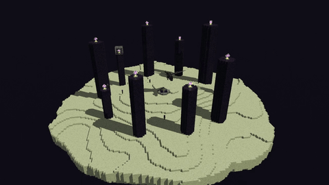

# Universidad del Valle de Guatemala

**Facultad de Ingeniería**

**Gráficas por Computadora**

## Proyecto 2: The End | Raytracing

**Juan Francisco Orozco Mijangos (24647)**

## Descripción

Este proyecto recrea la isla principal de The End de Minecraft mediante un diorama de cubos texturizados, con terreno procedural, pilares de obsidiana, cristales, portal y criaturas. Está implementado en Rust con su biblioteca estándar y utiliza raytracing en CPU para generar iluminación, sombras, reflexión, refracción, materiales emisivos y normales procedurales. Incluye rotación y acercamiento de la cámara, sin usar GPU ni librerías externas.

## Video



[Ver video del diorama](renders/diorama.mp4)


## Ejecución

Requiere Rust 1.85 o posterior. Desde la carpeta del proyecto:

```bash
cargo run --release -- preview
cargo run --release -- render
```

La vista previa genera `renders/preview.bmp`; el render final genera `renders/final.bmp` a 1920×1080 con 16 muestras por píxel. Estos archivos se producen localmente y no forman parte de la entrega.

Para controlar la cámara:

```bash
cargo run --release -- interactive
```

El visor muestra imágenes calculadas por Rust en CPU. Controles: `A/D` giran, `W/S` acercan y alejan, `R/F` cambian la altura y `0` restablece el encuadre. `Ctrl+C` en la terminal cierra el visor. Conserva 1200×675 al moverse y refina hasta cuatro muestras al detenerse.


FFmpeg se utiliza únicamente para codificar los fotogramas BMP ya renderizados. No participa en el cálculo de rayos ni es una librería del programa de Rust. No es necesario para ejecutar el proyecto.

## Escena y materiales

La escena contiene una isla procedural en una cuadrícula de 160×160 bloques, diez pilares de obsidiana, diez cristales, dos jaulas de hierro, el portal central, nueve Endermen y el Ender Dragon. El terreno tiene terrazas, bordes irregulares y espesor variable. Los bloques de terreno y pilares son cubos; los detalles usan cuboides y las membranas de las alas usan triángulos.

Cada material tiene textura procedural propia y parámetros independientes:

| Material | Textura | Albedo RGB | Specular | Transparencia | Reflectividad |
|---|---|---|---:|---:|---:|
| End Stone | Poros y fragmentos minerales | `(0.62, 0.65, 0.39)` | 0.035 | 0.00 | 0.008 |
| Obsidiana | Grano negro y fragmentos violetas | `(0.020, 0.014, 0.029)` | 0.12 | 0.00 | 0.004 |
| Vidrio del cristal | Detalles finos de superficie | `(0.60, 0.76, 0.82)` | 0.90 | 0.92 | 0.05 |
| End Crystal | Patrones rosados y celestes | `(0.84, 0.16, 0.67)` | 0.65 | 0.16 | 0.20 |
| Piel del dragón | Escamas negras | `(0.027, 0.025, 0.032)` | 0.14 | 0.00 | 0.02 |

El vidrio aplica refracción con índice 1.50, ley de Snell, Fresnel y absorción. Los medios anidados conservan el paso aire → vidrio → núcleo → vidrio → aire. La reflexión está presente en vidrio, aristas, hierro y portal. Las normales procedurales alteran la iluminación del terreno sin modificar su geometría. Los núcleos, fuego, antorchas y ojos son emisivos; los cristales y el portal cuentan con luces que iluminan las superficies cercanas. El skybox es un fondo púrpura procedural según la dirección del rayo.
